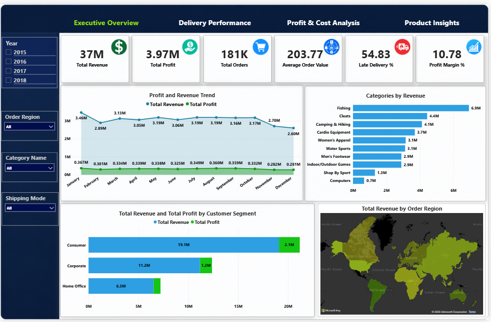
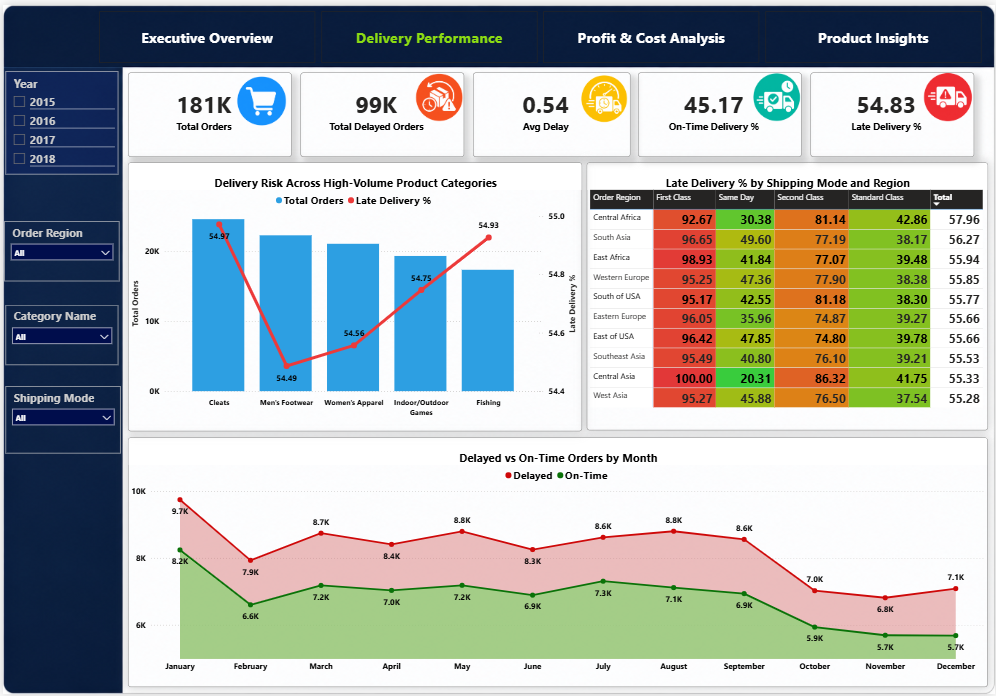
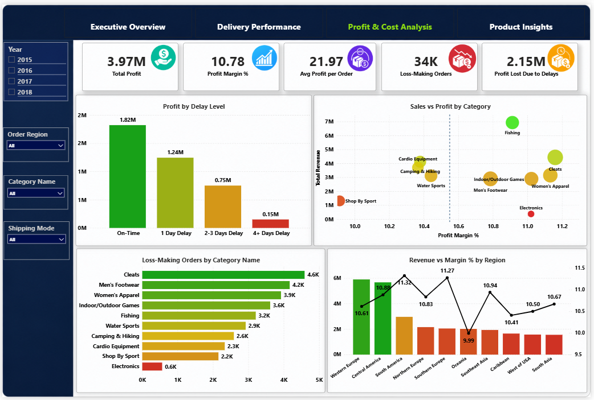
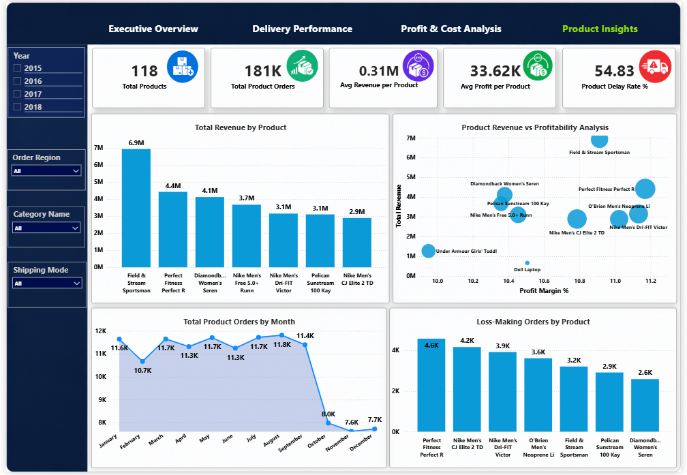

# 📦 Supply Chain Performance & Profitability Analytics

### End-to-End Data Analytics Project using Python, SQL, MySQL & Power BI


---

## 📖 Project Overview

Modern supply chains generate large volumes of operational and transactional data every day. However, high sales alone do not guarantee business success. Delivery delays, inefficient shipping methods, and low-margin products can significantly reduce overall profitability.

This project demonstrates an end-to-end data analytics workflow by transforming raw supply chain data into meaningful business insights. Using Python for data preprocessing, SQL for business analysis, MySQL for data management, and Power BI for visualization, the dashboard helps decision-makers monitor operational performance, identify problem areas, and support data-driven decisions.

The project focuses on answering real business questions rather than simply presenting charts, making it suitable for business intelligence and data analytics use cases.

---

# 🎯 Business Problem

Businesses often struggle to answer questions such as:

- Which shipping methods are responsible for the highest delivery delays?
- Which products generate high revenue but low profitability?
- Which customer segments contribute the most revenue?
- Which regions perform well and which require operational improvement?
- How much business performance is affected by delayed deliveries?

Without a centralized analytics solution, identifying these patterns becomes time-consuming and difficult.

This dashboard consolidates key business metrics into one interactive reporting solution.

---

# 🎯 Project Objectives

- Analyze sales, revenue and profitability trends.
- Measure delivery performance across shipping modes.
- Evaluate customer segment contribution.
- Identify loss-making products and categories.
- Compare regional business performance.
- Build an interactive executive dashboard.
- Support business decisions using data visualization.

---

# 🛠️ Tech Stack

| Technology | Purpose |
|------------|---------|
| Python | Data Cleaning & Preprocessing |
| Pandas | Data Manipulation |
| NumPy | Data Transformation |
| MySQL | Database Management |
| SQL | Business Analysis |
| Power BI | Interactive Dashboard Development |
| DAX | KPI Calculations |
| Power Query | Data Transformation |

---

# 🔄 Project Workflow

```text
Raw Dataset
      │
      ▼
Python Data Cleaning
      │
      ▼
MySQL Database
      │
      ▼
SQL Business Analysis
      │
      ▼
Power BI Data Modeling
      │
      ▼
Interactive Dashboard
      │
      ▼
Business Insights
```

---

# 📂 Repository Structure

```text
Supply-Chain-Performance-Analytics/
│
├── Dashboard/
│   └── Supply_Chain_Analytics_Dashboard.pbix
│
├── Dataset/
│   ├── Raw_Dataset.xlsx
│   └── Cleaned_Dataset.xlsx
│
├── Images/
│   ├── executive_overview.png
│   ├── delivery_performance.png
│   ├── profit_cost_analysis.png
│   └── product_insights.png
│
├── Python/
│   └── Data_Cleaning.ipynb
│
├── SQL/
│   └── Supply_Chain_SQL_Queries.sql
│
└── README.md
```

---

# 📊 Dataset Information

The dataset contains supply chain transactions collected over multiple years and includes information related to customers, products, shipping, revenue, profit, and delivery performance.

### Dataset Includes

- Customer Details
- Product Information
- Order Information
- Shipping Mode
- Delivery Status
- Revenue
- Profit
- Product Categories
- Regional Sales
- Order Dates

The cleaned dataset is used throughout the SQL analysis and Power BI dashboard development.

---
# 🧹 Data Cleaning & Preprocessing

Before building the dashboard, the raw dataset was cleaned and transformed using **Python (Pandas & NumPy)** to improve data quality and ensure accurate reporting.

### Data Cleaning Steps

- Removed duplicate records
- Checked and handled missing values
- Corrected inconsistent data types
- Standardized column names
- Validated numerical columns
- Created calculated fields required for analysis
- Removed unnecessary columns
- Exported the cleaned dataset for SQL and Power BI

The cleaned dataset was then imported into **MySQL** for SQL analysis and later connected to **Power BI** for dashboard development.

---

# 🧠 SQL Business Analysis

SQL was used to answer business questions and generate meaningful insights from the cleaned dataset.

### Business Questions Answered

- Which regions generate the highest revenue?
- Which customer segment contributes the most profit?
- Which shipping mode experiences the highest delivery delay?
- Which product categories generate maximum revenue?
- Which products create the highest number of loss-making orders?
- Which regions have the lowest profit margin?
- How does delayed delivery affect profitability?
- What are the monthly sales and order trends?

The SQL analysis helped validate business metrics before creating the Power BI dashboard.

---

# 📈 Dashboard Overview

The Power BI dashboard is divided into **four interactive pages**, each focusing on a different business area.

---

# 1️⃣ Executive Overview

This page provides a high-level summary of overall business performance.

### KPIs

- Total Revenue
- Total Profit
- Total Orders
- Average Order Value
- Late Delivery %
- Profit Margin %

### Visualizations

- Monthly Revenue & Profit Trend
- Revenue by Product Category
- Revenue & Profit by Customer Segment
- Revenue by Order Region (Map)

### Business Value

This page enables management to monitor the company's overall financial performance, customer contribution, and regional sales from a single dashboard.

---

# 2️⃣ Delivery Performance

This page focuses on logistics efficiency and delivery operations.

### KPIs

- Total Orders
- Delayed Orders
- Average Delivery Delay
- On-Time Delivery %
- Late Delivery %

### Visualizations

- Delivery Risk by Product Category
- Shipping Mode Performance
- Regional Delivery Heatmap
- Delayed vs On-Time Orders by Month

### Business Value

The dashboard highlights operational bottlenecks, identifies high-risk shipping methods, and helps improve delivery efficiency.

---

# 3️⃣ Profit & Cost Analysis

This page evaluates profitability across products, categories, and regions.

### KPIs

- Total Profit
- Profit Margin %
- Average Profit per Order
- Loss-Making Orders
- Profit Lost Due to Delays

### Visualizations

- Profit by Delay Level
- Sales vs Profit by Category
- Loss-Making Orders by Category
- Revenue vs Profit Margin by Region

### Business Value

This analysis helps identify areas where operational inefficiencies reduce profitability and supports better pricing and cost optimization decisions.

---

# 4️⃣ Product Insights

This page provides detailed product-level analysis.

### KPIs

- Total Products
- Product Orders
- Average Revenue per Product
- Average Profit per Product
- Product Delay Rate

### Visualizations

- Revenue by Product
- Product Revenue vs Profitability
- Monthly Product Orders
- Loss-Making Products

### Business Value

This page identifies high-performing products, products with poor profitability, and categories that require business attention.

---

# 📊 Dashboard Preview

## Executive Overview

```markdown

```

---

## Delivery Performance

```markdown

```

---

## Profit & Cost Analysis

```markdown

```

---

## Product Insights

```markdown

```

---

# 📌 Key Business Insights

- Delivery delays significantly affect business profitability.
- High revenue does not always translate into high profit margins.
- Customer segments contribute differently to revenue and profit.
- Regional performance varies considerably across the business.
- Several high-volume products generate lower-than-expected profitability.
- Interactive dashboards enable faster and more informed business decisions.
---

# 💼 Business Impact

This project demonstrates how data analytics can support business decision-making by transforming raw operational data into actionable insights.

The dashboard helps businesses to:

- Monitor overall sales and profitability performance.
- Identify delivery delays and operational bottlenecks.
- Compare regional performance across multiple markets.
- Evaluate customer segment contribution.
- Detect loss-making products and categories.
- Track KPIs through an interactive executive dashboard.
- Support data-driven strategic planning.

---

# 📌 Strategic Recommendations

Based on the analysis, the following business recommendations can improve operational performance:

### 🚚 Improve Delivery Performance

Monitor shipping methods with high delay rates and optimize logistics planning to improve customer satisfaction.

### 💰 Focus on Profitability

Review pricing strategies for products with high sales but low profit margins.

### 🌍 Optimize Regional Operations

Allocate resources toward high-performing regions while investigating operational challenges in underperforming areas.

### 📦 Improve Product Portfolio

Identify products with consistently low profitability and evaluate pricing, sourcing, or inventory strategies.

### 📊 Track Business KPIs

Use interactive dashboards to monitor revenue, profit, delivery performance, and customer trends regularly.

---

# 🚀 Skills Demonstrated

This project demonstrates practical experience in:

- Data Cleaning
- Data Preprocessing
- Exploratory Data Analysis (EDA)
- SQL Query Writing
- MySQL Database Management
- Power BI Dashboard Development
- DAX Measures
- Power Query
- Data Modeling
- KPI Design
- Business Intelligence
- Data Visualization
- Business Storytelling
- Analytical Thinking

---

# ▶️ How to Run the Project

### 1. Clone the Repository

```bash
git clone https://github.com/rahulkumar200410/Supply-Chain-Analytics-SQL-Python-PowerBI.git
```

---

### 2. Import Dataset

Import the cleaned dataset into MySQL.

---

### 3. Execute SQL Queries

Run the SQL queries available inside the `SQL` folder to reproduce the business analysis.

---

### 4. Open Power BI Dashboard

Open the `.pbix` file using **Microsoft Power BI Desktop**.

---

### 5. Explore the Dashboard

Use filters and slicers to analyze:

- Revenue
- Profit
- Delivery Performance
- Product Insights
- Regional Performance
- Customer Segments

---

# 📈 Future Improvements

Possible future enhancements include:

- Real-time dashboard using live database connections
- Automated ETL pipeline
- Demand forecasting using Machine Learning
- Interactive drill-through reports
- Advanced customer segmentation
- Integration with cloud databases

---

# 📚 Project Highlights

✔ End-to-End Data Analytics Project

✔ Python Data Cleaning

✔ SQL Business Analysis

✔ MySQL Database

✔ Interactive Power BI Dashboard

✔ Business KPI Reporting

✔ Executive Dashboard Design

✔ Data-Driven Business Insights

---

# 🤝 Connect With Me

## Rahul Kumar Sao

🎓 Final Year B.Tech Student | Aspiring Data Analyst

📌 **GitHub**

https://github.com/rahulkumar200410

📌 **LinkedIn**

https://www.linkedin.com/in/rahul-kumar-sao-8a5175322

---

## ⭐ If you found this project useful, consider giving it a Star!

Feedback and suggestions are always welcome.

---

**Thank you for visiting this repository!**